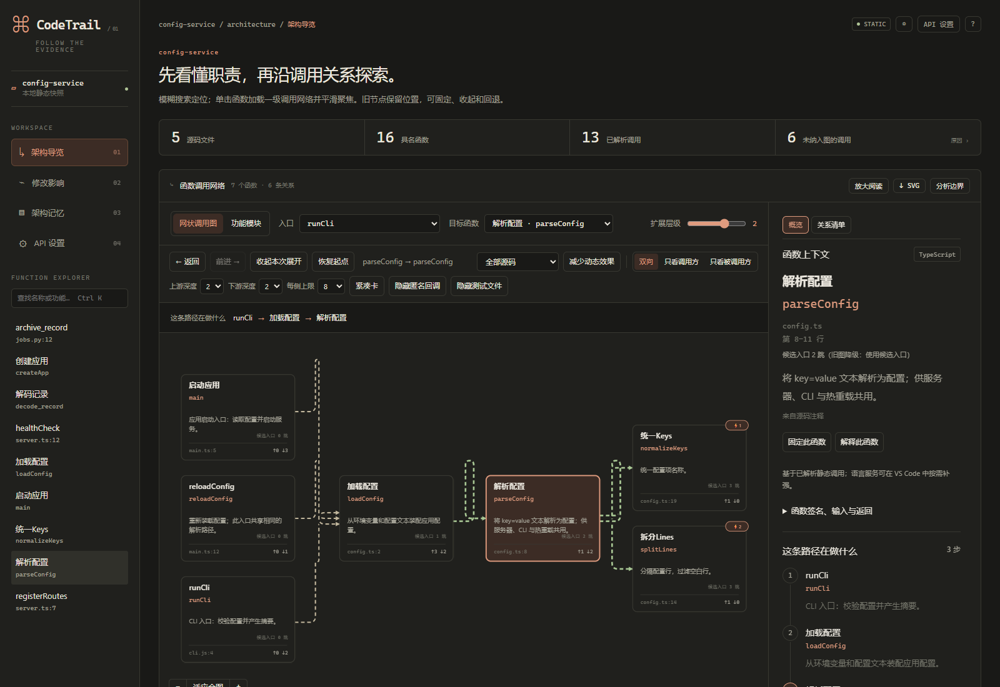
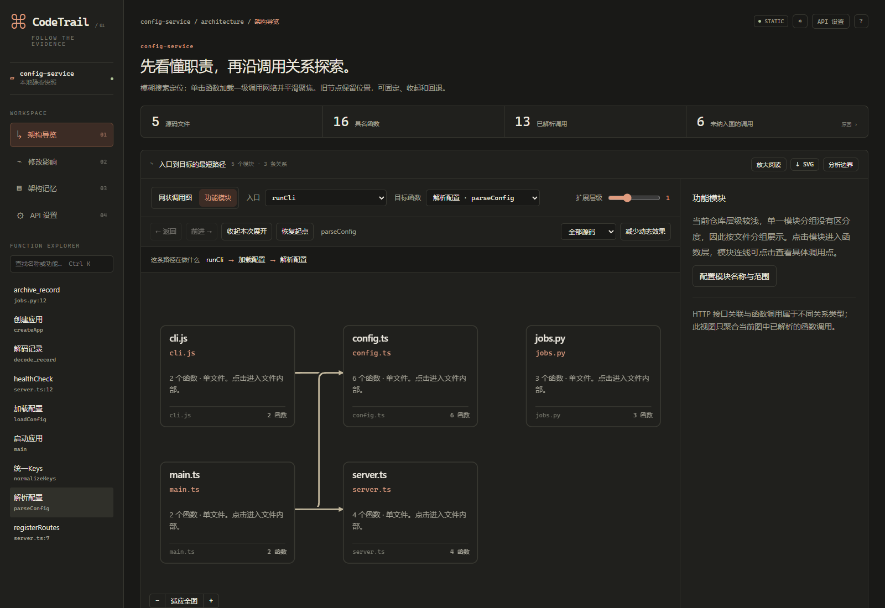
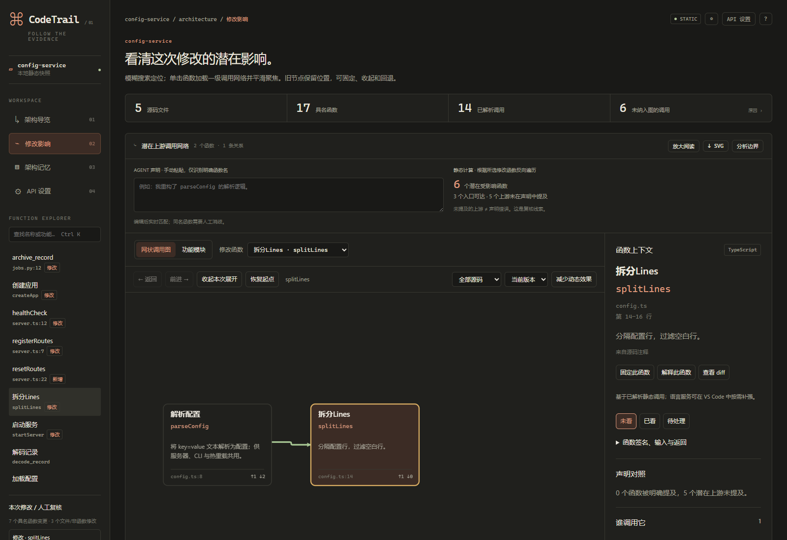

# CodeTrail

在 Agent 写代码之后，用模糊搜索与交互式函数调用网络帮助开发者定位、理解和复核修改。核心由 Rust 编写；独立 HTML 与 VS Code Webview 共用同一套阅读和探索逻辑。当前版本 0.6.0，发布者 `wwwh7`。

[VS Code Marketplace](https://marketplace.visualstudio.com/items?itemName=wwwh7.codetrail-app)（扩展 ID `wwwh7.codetrail-app`，显示名 CodeTrail） · [下载预编译版本（GitHub Releases）](https://github.com/wwwh7-cypher/CodeTrail/releases) · [Agent Skill 入口](SKILL.md) · [验证记录与边界](VERIFICATION.md) · [发布说明](docs/RELEASING.md)

## 截图

以下截图由 `node scripts/render-doc-screenshots.cjs` 生成：架构与模块图扫描仓库内示例项目 `examples/config-service`，修改影响图来自同一示例的临时 Git 副本（含脚本生成的演示改动），因此可直接复现。



*搜索定位函数并展开调用网络（示例展示两层）；虚线表示静态/候选解析，节点角标 ⚡N 为未解析调用数；右侧检查器可切换到关系清单。*



*功能模块视图按目录/文件边界聚合实际已解析的调用，模块卡展示文件/函数数、出入模块与调用点数及不稳定度；浅层仓库按文件分组。*



*Git 修改影响：新增/修改/删除函数与调用边，函数队列与非函数文件队列分开复核；检查器单列未解析调用与候选入口距离。*

## 5 分钟上手

### 1. VS Code（Windows x64）

1. 在扩展视图搜索 **CodeTrail**（publisher `wwwh7`，扩展 ID `wwwh7.codetrail-app`）从 [VS Code Marketplace](https://marketplace.visualstudio.com/items?itemName=wwwh7.codetrail-app) 安装；也可从 [Releases](https://github.com/wwwh7-cypher/CodeTrail/releases) 下载发布的 VSIX，或直接使用本地构建产物 `output/code-trail-0.6.0-win32-x64.vsix`，选择“从 VSIX 安装”。
2. 重新加载窗口。
3. 打开任意本地项目，运行命令 `CodeTrail: 打开架构导览`。
4. 输入函数缩写、文件名或已有中文职责并回车；单击节点继续展开。`Ctrl+Alt+G` 在编辑器中定位当前函数。

普通搜索、看图与 Git 审查不依赖模型；只有“解释此函数”需要自备 API（见下文两种模型入口）。

调用图中拖动节点或空白处即可平移，单击节点查看详情。鼠标位于图内或焦点在图上时，`Ctrl + [` 缩小、`Ctrl + ]` 放大、`Ctrl + 0` 适应全图；也可用 `Ctrl + 滚轮` 缩放、`Shift + 滚轮` 平移。普通滚轮滚动页面。Mac 使用 `⌘` 替代 `Ctrl`。方向开关、上下游深度、每侧上限与关系清单等控制见下文“查看器能力”。

VS Code 分屏调整保留当前视角；窄屏下详情随页面滚动，源码跳转和 diff 复用源码编辑器组。“解释此函数”直接使用已配置的 API，不再弹出调用前确认。

### 2. 命令行与独立 HTML

从 Releases 下载 skill 压缩包（内含 `bin/code-trail.exe`），或在本仓库构建二进制：

```powershell
pwsh -File scripts/build.ps1
& .\bin\code-trail.exe scan .\examples\config-service --out .\output\architecture.html --cache .\output\parse-cache.json
& .\bin\code-trail.exe query .\output\architecture.graph.json search 'config'
& .\bin\code-trail.exe review . --base HEAD --out .\output\review.html
Start-Process .\output\architecture.html
```

HTML 自包含、无需服务器；VS Code 版对同一份图使用启用脚本的 Webview。同名函数需使用输出中的唯一 ID 或 `symbol_key`。`review . --base HEAD` 展示当前工作区相对 HEAD 的改动；扫描其他项目时把 `.` 换成目标路径。

扫描与审查可用 `--module-depth`、`--module-group` 控制模块聚合，配置会写入代码图并由查看器/MCP 共用：

```powershell
# 模块分段深度：0 为自动（src/backend 首段取 3 段，其余 2 段）；单段文件以文件路径本身为模块
& .\bin\code-trail.exe scan .\examples\config-service --module-depth 2 --out .\output\architecture.html
# 自定义分组按相对路径前缀匹配，可重复；按声明顺序取第一个匹配
& .\bin\code-trail.exe scan .\examples\config-service --module-group 配置=config.ts --module-group 入口=main.ts --out .\output\grouped.html
# 模块摘要：默认只输出统计、跨模块边与循环；--full 才展开 files/functions/evidence
& .\bin\code-trail.exe query .\output\architecture.graph.json modules
& .\bin\code-trail.exe query .\output\architecture.graph.json modules --full
```

`review` 接受相同参数，模块配置同时写入审查图和基线内嵌图。

模块定义现在由 Rust 在扫描/审查时算好并写入图：每个函数带 `module` 与 `exported`（是否导出，供入口分类使用），图顶层带 `module_depth` 与 `module_groups`；旧图缺少这些字段时，查询与渲染按同一算法回退。`query modules` 默认输出 `module_config`、`summary`（模块/文件/函数数、跨模块调用对与调用点、循环数）、`modules`、`edges`、`cycles`；摘要里的 `instability` = 出向调用点 ÷（入向 + 出向调用点），没有跨模块调用时为 `null`。MCP 的 `code_trail_modules` 返回同一份摘要。模块与 instability 只是对已解析跨模块调用的聚合口径，不是架构评分。

### 3. Agent Skill

把 Releases 中的 skill zip 解压为 Agent 的 `skills/code-trail` 目录（zip 已包含 `bin/` 原生二进制）：

```text
code-trail scan <repository> --out <output>/architecture.html --cache <output>/parse-cache.json
code-trail query <output>/architecture.graph.json search "parseConfig" --limit 20
```

由当前对话模型解释源码，再通过 `prepare-annotations` / `annotate` 写入经过 Rust 结构校验的说明，无需额外 API Key。完整工作流见 [SKILL.md](SKILL.md)。

## 查看器能力

独立 HTML 与 VS Code Webview 共用同一套查看器。扫描写入的仍是函数、已解析调用边、未解析调用和模块键；下列交互与图表是对这些事实的展示派生。

**显式编码**

- 多个调用点聚合成一条边并标 `×N`；`resolution` 含 `static`/`candidate` 的调用画虚线（如 C/C++ 的 `c-include-static`、显式导入的静态候选），其余已解析调用画实线，图例常驻画布。
- 函数卡右上角 `⚡N` 表示该函数未进入图的调用条数，点击按原因分组查看位置；检查器也会单列未解析项。未解析是静态缺口，不等于运行时不可达。
- 模块视图用 `⇄` 高亮双向/循环依赖（同一强连通分量）；是否合理仍需人工判断。

**范围与展开控制**

- 方向开关在“双向 / 只看调用方 / 只看被调用方”之间切换；上游深度与下游深度分别控制两侧展开层数（0–3）。
- 每侧上限（4/8/12/16）限制第一层邻居的绘制数量。超过上限时只画按“同模块优先、调用点数降序、扇入降序、名称”排序的 Top-N，其余给出一张“其余 K 个”聚合卡；点击聚合卡才展开剩余邻居，聚合只影响显示。
- 节点较多或缩放较小时自动切换紧凑卡与 LOD 细节层级，也可手动切换紧凑卡。
- 范围下拉从当前图派生（全部源码、顶层目录、`module_groups` 前缀等）；可单独隐藏匿名回调与测试文件。

**阅读与清单**

- 检查器分为“概览”和“关系清单”。关系清单用三张表列出调用方、被调用方与未解析调用，可按功能名、`文件:行`、调用点数、解析方式、入口跳数排序；点击行聚焦函数、查看调用证据，或把整份清单复制为 JSON。表格不依赖画布。
- 入口按显式入口、`main`/启动、导出 API、CLI/HTTP 候选、匿名回调、普通候选分组。选中函数显示“入口 N 跳”或“候选入口 N 跳”（旧图降级为候选入口）。这些是静态图上的启发式分类与距离，不是运行时入口证明。

**模块视图**

- 模块卡与检查器展示文件数、函数数、入向/出向模块数、入向/出向调用点数和“不稳定度”（`instability` = 出向调用点 ÷（入向 + 出向调用点）；CLI 摘要中无跨模块调用时为 `null`）。
- 可只看目标模块的邻居，或勾选“包含邻居间依赖”查看整体依赖；全量依赖表可排序并复制 JSON。
- review 图按模块键汇总本次变更（新增/修改/删除数量），列表项可点击定位到对应函数；这是从 `review.changes` 派生的展示，不新增扫描事实。

## 两种模型入口

**VS Code（BYOK）：** 设置 Provider、API Base URL、可选 Models URL、Model ID 与 API Key；Key 保存在 SecretStorage，按协议与来源隔离。支持 OpenAI-compatible 与 Anthropic 协议。

**Agent Skill：** 使用当前对话模型，无需额外 Key，也不复制插件凭据。说明只描述函数职责，任何模型叙述都不会决定调用关系。

## 平台与分发

- **预编译产物仅 Windows x64**：VSIX 要求 VS Code `^1.100.0`；Skill zip 内含 Windows x64 原生二进制。
- **分发渠道**：VS Code 插件已发布到 [VS Code Marketplace](https://marketplace.visualstudio.com/items?itemName=wwwh7.codetrail-app)（publisher `wwwh7`，扩展 ID `wwwh7.codetrail-app`，显示名 CodeTrail）与 GitHub Releases。Marketplace 要求扩展 `name` 全局唯一，`code-trail` 与 `codetrail` 已被其他发布者占用，因此 ID 使用 `codetrail-app`，安装后在扩展列表显示为 CodeTrail。Skill/Source zip 只通过 GitHub Releases 发布。
- **其他平台**需从源码构建：`cargo build --release --locked`，二进制位于 `target/release/code-trail`。Windows 本地可用 `scripts/build.ps1`；`.cargo/config.toml` 仅为 `x86_64-pc-windows-gnu` 目标配置链接器。
- `output/` 是本地构建/演示目录（已 gitignore），不进入仓库；预编译资产只从 Marketplace 或 Releases 获取。
- 仓库不提交生成产物：`bin/`、`extension/bin/`、`extension/LICENSE` 以及 VSIX/Skill/源码 zip 均由构建或打包脚本生成。

## 构建与测试

```powershell
pwsh -File scripts/build.ps1            # Rust 发布构建，产物复制到 bin/
cargo +stable-x86_64-pc-windows-gnu test --locked
npm --prefix extension ci
npm --prefix extension run test:unit
npm --prefix extension run test:vscode
npm --prefix extension run package      # output/code-trail-<version>-win32-x64.vsix
python scripts/package-skill.py         # output/code-trail-<version>-{skill,source}.zip，需先构建 bin/
node scripts/render-doc-screenshots.cjs # 重新生成 docs/screenshots/*.png
```

- VS Code 集成测试需要真实 Git 项目与 VS Code：用 `CODETRAIL_REAL` 指定项目，用 `CODETRAIL_VSCODE` 指定 `Code.exe`。未设置且检测不到项目时会打印跳过说明并正常退出；检测不到 VS Code 时给出明确错误。若 shell 设置了 `ELECTRON_RUN_AS_NODE=1`（部分 Electron 工具链会设置），运行 `test:vscode` 前需先移除该变量。
- VSIX 内置 `extension/bin/code-trail[.exe]`；仓库不再提交该二进制。全新克隆后首次运行 `test:vscode` 前，先执行 `npm --prefix extension run package`（它会复制二进制、生成 `extension/LICENSE` 并按当前构建刷新 `extension/media/viewer.html`），或手动把 `bin/code-trail.exe` 复制到 `extension/bin/`，或在 VS Code 设置 `codeTrail.binaryPath` 指向本机 CLI。
- 浏览器回归：先运行 `node scripts/verify-native.mjs`，再运行 `node scripts/verify-explorer.cjs`。需要额外验证已生成的最终产物时，可再加 `--final-architecture <html>`、`--final-review <html>`（默认使用内置 fixture 与 `output/native-test/` 产物）。Playwright 与 Chromium 由 `scripts/lib/browser-env.cjs` 解析，可用 `PLAYWRIGHT_MODULE`、`CHROMIUM_PATH` 覆盖，也可临时安装 Playwright（这些开发者依赖不进入 VSIX）。
- 截图脚本默认扫描 `examples/config-service`（架构/模块）并生成一个带演示改动的临时 Git 副本（修改影响）；也可用 `--architecture-html`、`--modules-html`、`--review-html` 复用已生成的 HTML（例如本机的 research-atlas 预览），或用 `--project` 指定要扫描的项目。`--help` 列出全部参数。
- 发布所需资产与命令见 [docs/RELEASING.md](docs/RELEASING.md)。

## 解释边界

支持 TS/TSX/JS/JSX、Svelte script、Python、Go、C 与 C++ 的语法索引。Go 支持同包函数、已知接收者与有明确结构字段类型的静态候选调用。C/C++ 只把函数定义建为节点（原型不是节点）：C 解析同文件词法调用、本地引号 `#include` 文件与头文件对应的同目录实现文件（静态候选边标记为 `c-include-static`）；C++ 额外解析 `this->method()`、同一类内的非限定兄弟方法与唯一的 `Class::method` 候选。对象/指针/函数指针上的成员调用需要类型信息，会以明确原因保持未解析（属于静态缺口，不是源码错误）；系统头文件按外部依赖处理，未集成 clang/类型检查器。解析器发生语法恢复时，诊断以 `path:line:col: ...` 形式给出；它只说明该文件在此处的静态索引可能不完整，不等同于项目编译失败。接口分派、动态回调连接、外部包和框架注册可能需要语言服务或人工复核；语言服务同样只是静态证据，不能证明完整运行时影响。

模块边只聚合已解析的跨模块函数调用；HTTP 关联需要单独证据，不会被冒充为函数调用。VS Code 运行时额外提供源码跳转、原生 diff、持久化复核状态、SecretStorage 与可选语言服务补强；离线 HTML 对这些入口给出明确说明。

查看器里的 `×N`、`⚡N`、Top-N 聚合、紧凑卡/LOD、关系清单排序、入口分类与距入口跳数、模块指标与 review 模块级变更都属于展示派生：它们不新增调用关系，也不改变未解析调用的语义。入口分类是启发式候选，不是运行时入口证明；`instability` 是已解析跨模块调用点的比例，不是架构质量评分。

稳定记忆持久化硬限制为 1,500 个 cl100k_base tokens；离线 HTML 导出采用更保守的 1,500 UTF-8 字节预算，两者均需用户确认。MCP 只提供读取/查询工具，不暴露写入或模型调用。静态可达性只说明潜在影响，不证明运行时行为变化或审查充分性。

## 文档

- [VERIFICATION.md](VERIFICATION.md)：本机实际执行结果、证据位置与未覆盖边界。
- [extension/CHANGELOG.md](extension/CHANGELOG.md)：版本变更记录。
- [PRODUCT_PLAN.md](PRODUCT_PLAN.md)：产品计划与验收目标；目标指标不等于已证实的实用效果。
- [USER_TEST_PROTOCOL.md](USER_TEST_PROTOCOL.md)：真人对照验收方法。
- [SKILL.md](SKILL.md)：Agent Skill 使用入口。
- [references/](references/)：分析边界与说明写回契约。
